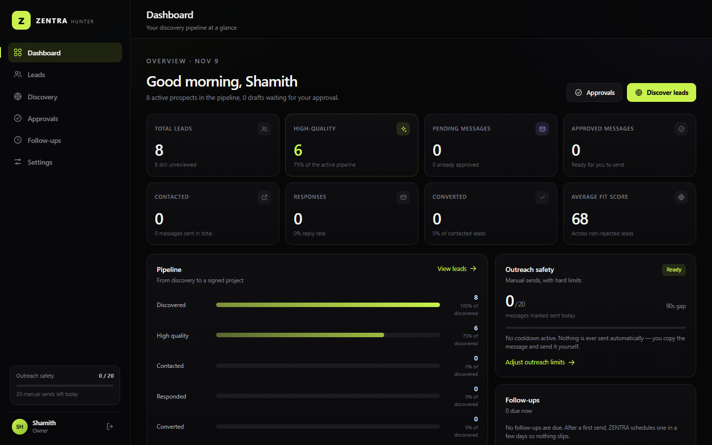
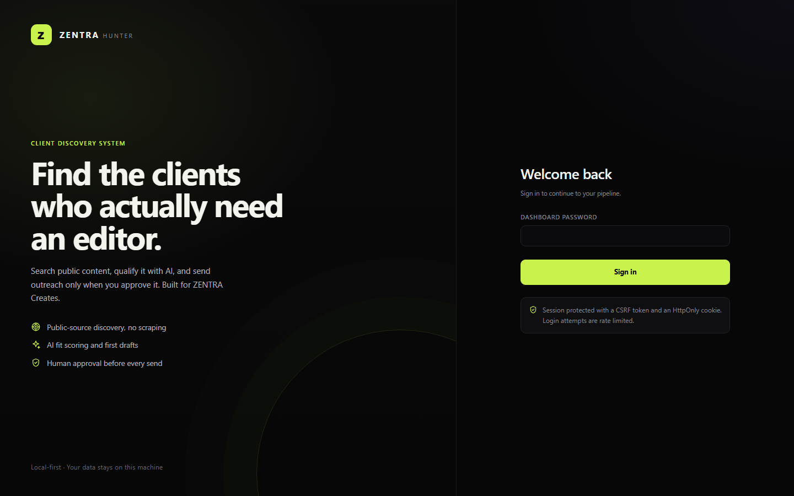

# ZENTRA Hunter

<p align="center">
  
</p>

<p align="center">
  
  
  
  
  
</p>

A private, local-first lead discovery and outreach assistant for **ZENTRA Creates**.
It finds public prospects, scores them, drafts a personalised DM, and waits for you to approve,
copy and send each message yourself.

Nothing is ever sent automatically. There is no bulk-send feature, no scraping of private data,
and no CAPTCHA or login bypass.

## Screenshots

| Dashboard | Sign in |
| --- | --- |
|  |  |

## What this project demonstrates

- Dependency-free Node.js server with a small hand-written router and session layer.
- SQLite persistence through the built-in `node:sqlite` module.
- Encrypted credentials at rest, password hashing, CSRF protection, login throttling and origin checks.
- Public-data discovery providers (Google Places, Meta) and an AI drafting layer with per-lead fit scoring.
- Human-in-the-loop approvals, follow-up scheduling and manual send only.

---

## Requirements

- **Node.js 24 or newer** (uses the built-in `node:sqlite` module)
- No npm dependencies, no build step
- Windows, macOS or Linux

Check your version:

```bash
node -v
```

## Run it

```bash
cd zentra-hunter
node server/index.js
```

Then open **http://127.0.0.1:8787** and create your dashboard password on the first screen.

On startup the console prints both addresses:

```
  Local:  http://127.0.0.1:8787
  LAN:    http://192.168.1.20:8787  (Wi-Fi)
```

The LAN URL is what your phone uses on the same WiFi.

For development with auto-restart:

```bash
npm run dev
```

On Windows, two double-click files are included:

- `start-app.bat` — starts the dashboard server (keep the window open)
- `start-phone-tunnel.bat` — starts a Cloudflare quick tunnel for phone access;
  copy the `https://….trycloudflare.com` link it prints

The server must already be running when you start the tunnel.

## First-run configuration

1. **Set a password** — the setup screen hashes it with scrypt. It is stored in `data/zentra.db`.
2. **Settings → Brand** — check the studio name, owner name, services, portfolio link and Instagram.
   These are used in every generated message.
3. **Settings → Outreach safety** — the safe defaults are:
   - 20 manual sends per day
   - 90 second minimum gap between sends
   - first follow-up after 3 days, second (final) after 7 days
4. **Settings → Data & privacy** — optionally load the 8 demo leads to explore the workflow,
   then remove them before you start real prospecting.

Everything lives in `data/` (SQLite database, encryption key). Back up that folder; never commit it.

## Remote access (phone / anywhere)

The app still runs on your machine and is still password protected. You choose how to reach it — no
automatic public hosting. The same guide is in **Settings → Remote access**, with your detected URLs
and copy buttons.

### Method 1 — Same WiFi (LAN)

1. Run with `HOST=0.0.0.0` (default). Restart after changing `.env`.
2. Connect the phone to the same WiFi and open `http://YOUR-PC-IP:8787` (shown in the console and
   in Settings → Remote access).
3. Sign in with your dashboard password.
4. If it does not load: allow Node.js on **Private networks** in Windows Firewall, or allow inbound
   TCP 8787.

Only do this on WiFi you trust — anyone on the network can reach the login page.

### Method 2 — Cloudflare Tunnel (recommended for anywhere)

Works on mobile data with no router changes and no paid plan.

```bash
# install once (Windows)
winget install --id Cloudflare.cloudflared

# keep the app local, then start the tunnel in a second terminal
HOST=127.0.0.1 node server/index.js
cloudflared tunnel --url http://127.0.0.1:8787
```

Open the printed `https://….trycloudflare.com` link on your phone. The quick-tunnel URL changes on
each restart. For a stable hostname and an extra login layer, use a named tunnel with Cloudflare
Access. A quick tunnel is public: use a long password and close it when done.

### Method 3 — Tailscale (private, no public URL)

1. Install Tailscale on the PC and the phone; sign in to the same account (free personal plan).
2. Keep `HOST=0.0.0.0`, then run `tailscale ip -4` to get a `100.x.y.z` address.
3. Open `http://100.x.y.z:8787` on the phone — it works on WiFi and mobile data.
4. Only devices in your Tailnet can connect; the dashboard password still applies.

### Remote access security

- Set a strong password before exposing anything; login attempts are throttled per IP.
- Do **not** port-forward 8787 on your router. Use a tunnel or Tailscale.
- Over HTTPS, session cookies are marked `Secure` automatically (via `x-forwarded-proto`). Set
  `SECURE_COOKIES=true` only if you always use HTTPS — plain-HTTP LAN logins would stop working.
- Stop the server or tunnel when you are finished, especially on shared WiFi.
- Remote access changes nothing about outreach: messages are still sent by hand and confirmed by you.

## AI setup (optional)

The app works without an AI key: messages and analysis fall back to local templates and scoring.
To enable AI drafting and analysis, go to **Settings → AI assistant** and pick a provider:

| Provider | Notes |
| --- | --- |
| OpenAI | `https://api.openai.com/v1`, default model `gpt-4o-mini` — paid API key |
| OpenRouter | One key for many models — paid |
| Groq | Fast free tier with limits |
| Ollama | Local, free; run `ollama serve` and use `http://localhost:11434/v1` |
| Custom | Any OpenAI-compatible `/chat/completions` endpoint |

The key is encrypted with AES-256-GCM using a key from `APP_SECRET` (or an auto-generated
`data/.app_secret`). If AI fails or is not configured, the app silently falls back to its local
templates so your workflow never breaks.

## Lead discovery options

Open **Discovery** and choose a method:

1. **Guided discovery (no setup)** — one-click Google searches for public posts where people ask
   for an editor or post their own reels, plus profile lookup links. Free and always available.
2. **Bulk paste / CSV import** — paste `name, platform, profile_url, country, category, notes`
   rows or upload a CSV you already have. Dedupe and scoring apply automatically.
3. **Google Programmable Search (optional)** — 100 free queries per day.
   Create a key at the Google Cloud Console, enable "Custom Search API", create a Programmable
   Search Engine restricted to `instagram.com` and `facebook.com`, then paste the **API key** and
   **Search Engine ID (cx)** in **Settings → Google Search**. No paid plan required for the free tier.
4. **Meta Graph API (optional)** — hashtag scan and public business-profile lookup.
   Requires an Instagram **Business or Creator** account linked to a Facebook Page, a Meta app,
   and the `instagram_basic`, `pages_show_list`, `pages_read_engagement` permissions
   (app review may be required). Add the access token and IG user ID in **Settings → Instagram API**.

**Important:** Meta's API does **not** allow cold DMs, and this app never sends through it. Meta
discovery only reads public professional-account data; messaging stays manual, from your own app.

## Daily workflow

1. **Discovery** → collect candidates (or add leads manually).
2. **Leads** → filter by fit score, priority, country, platform; open a lead to see why it fits.
3. **Approve** → generate or edit a message, review the spam/duplicate checks, approve it.
4. **Send manually** → click *Copy & open profile*, send the DM yourself, then click
   *I've sent it* to start the follow-up timer and quota counter.
5. **Follow-ups** → a nudge appears when due. Draft, approve and send it the same way.
   Maximum two follow-ups per lead; the queue stops automatically once a lead responds or converts.
6. Mark the lead **Responded** or **Converted** when it happens, so stats stay honest.

Editing any approved message resets it to draft, so what you send is always the text you last
reviewed. The send limits (daily cap, minimum gap) are enforced by the server, not just the UI.

## What needs paid or API access

- **Sending messages automatically** — not available by design; platform rules forbid it.
  Everything is copy-and-send from your account.
- **OpenAI / OpenRouter keys** — paid. Groq's free tier works with limits. Ollama is free/local.
- **Google Custom Search** — free 100 queries/day, then billed by Google.
- **Meta Graph** — no fee, but requires a professional account, a Meta app and permissions.
- Guided discovery, manual entry, CSV import/export, scoring and template drafts work offline and free.

## Security and data

- Password hashing: scrypt with per-password salt
- Sessions: random tokens stored hashed, HttpOnly + SameSite=Strict cookies, CSRF header checks
- Secrets: encrypted at rest (AES-256-GCM), key auto-generated in `data/.app_secret`
- Login throttling, same-origin checks, CSP and security headers on every response
- No external requests except the provider you configure (AI, Google, Meta)
- Binds to `HOST` from `.env` (default `0.0.0.0`, so devices on your WiFi can reach it). Set
  `HOST=127.0.0.1` to keep it on this computer only. Never port-forward 8787 — use Cloudflare
  Tunnel or Tailscale for access outside your network. HTTPS requests get `Secure` cookies
  automatically.

### Environment variables

Copy `.env.example` to `.env` only if you need to change defaults:

```env
PORT=8787
HOST=0.0.0.0         # 127.0.0.1 = this computer only; 0.0.0.0 = also your WiFi
APP_SECRET=          # optional; otherwise generated once in data/.app_secret
APP_PASSWORD=        # optional first-boot password; remove after setup
SECURE_COOKIES=false # true only if you always use HTTPS
```

### Forgot the password / start over

There is no email recovery. Either set a new `APP_PASSWORD` and delete `data/zentra.db`
(removes all data), or restore a backup of `data/`.

## Project structure

```
server/
  index.js        HTTP server, auth routes, static files
  db.js           SQLite schema and settings helpers
  ai/             lead scoring/analysis, message generation, LLM client
  providers/      Google Custom Search and Meta Graph clients
  routes/         leads, messages, discovery, settings APIs
  lib/            outreach limits, spam checks, validation, crypto, LAN address detection
public/
  index.html, app.js, styles.css, views/   responsive single-page dashboard
data/             database + encryption key (gitignored)
```

## Troubleshooting

- **Port in use** — set `PORT=8788` in `.env` or stop the other process.
- **Phone cannot open the LAN URL** — confirm both devices are on the same WiFi, `HOST=0.0.0.0`, and
  Node.js is allowed on the current network profile in the firewall. Guest WiFi often blocks
  device-to-device traffic; use a tunnel instead. The PC's IP can change after a reboot — recheck the console.
- **Your phone is the hotspot** — devices tethered to a phone (especially iPhone) often cannot be
  reached *from* that phone, because the hotspot isolates clients. Use Cloudflare Tunnel or Tailscale
  (Methods 2 and 3); the phone then connects over its own mobile data.
- **LAN page loads but login does not stick** — `SECURE_COOKIES=true` blocks cookies over plain HTTP.
  Keep it `false` for LAN, or access only via HTTPS.
- **`ERR_UNKNOWN_BUILTIN_MODULE: node:sqlite`** — you are on an older Node; install Node 24+.
- **"Please wait Ns before marking another message as sent"** — the 90s anti-spam gap; lower it in
  Settings → Outreach safety only if you understand the risk.
- **AI warning toast** — the provider failed; the local template was used instead. Check the key
  and model in Settings → AI assistant.
- **Changes to frontend JS not appearing** — the app is a hash-routed SPA; hard-reload with
  `Ctrl+Shift+R` after editing files.
